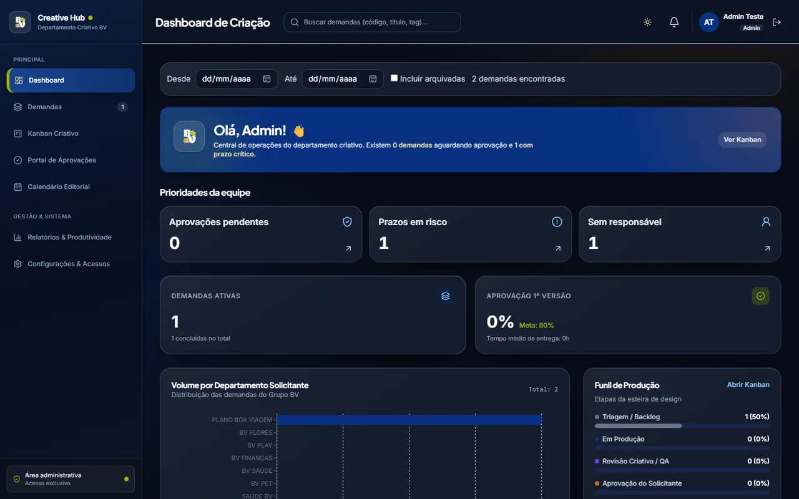

# BV Creative Hub

Aplicação do Grupo BV para solicitar materiais criativos e acompanhar briefing, produção, revisão, aprovação e entrega.

**Produção** · [Abrir o BV Creative Hub](https://bvcreativehub1.vercel.app/) · [Verificar disponibilidade da API](https://bvcreativehub1.vercel.app/api/health)



*Dashboard em ambiente de demonstração com dados fictícios.*

## Funcionalidades

- **Acesso e perfil** — cadastro de colaborador com e-mail e confirmação de senha, login, recuperação por código enviado por e-mail e foto de perfil por upload.
- **Solicitações** — briefing estruturado, rascunho salvo no navegador, validação de prazo e contatos de entrega e confirmação com código após o envio. Para materiais impressos, o formulário exige largura, altura e unidade.
- **Acompanhamento** — dashboards por perfil, pesquisa, filtros, cards no celular, detalhes da demanda e atalhos para as pendências da equipe.
- **Produção e aprovação** — Kanban, atribuição de responsável e aprovador, comentários, checklist e parecer formal. Reabertura e arquivamento registram motivo.
- **Histórico e avisos** — linha do tempo com mudanças de etapa, atribuições, comentários e pareceres. O sino avisa o solicitante sobre ajustes e conclusão. As marcações de leitura ficam salvas no navegador.
- **Gestão** — calendário, relatórios com indicadores de produtividade e SLA, exportação de demandas em CSV, gestão de departamentos e acessos e convites para perfis da equipe.

## Perfis

| Perfil | Acesso |
| --- | --- |
| Solicitante | Cria demandas e acompanha as próprias solicitações, comentários, pareceres e avisos. |
| Executor | Acompanha e movimenta as demandas sob sua responsabilidade. |
| Aprovador | Revisa demandas delegadas e registra pareceres. |
| Administrador | Gerencia demandas, departamentos, atribuições, convites e acessos. |

## Stack e estrutura

React 19, TypeScript, Vite, Tailwind CSS, Express e PostgreSQL. A Vercel serve o frontend e encaminha as rotas `/api/` para a aplicação Express.

| Caminho | Conteúdo |
| --- | --- |
| `src/` | Interface, cliente da API, catálogo de formatos e regras compartilhadas. |
| `backend/` | Rotas Express, autenticação, permissões e acesso ao PostgreSQL. |
| `api/` e `server.ts` | Pontos de entrada na Vercel e no servidor local. |
| `database/migrations/` | Migrações do banco usado pela aplicação. |
| `public/` | Assets, páginas legais, página 404, sitemap e robots.txt. |
| `scripts/` e `tests/` | Migração, pacote de código-fonte e testes automatizados. |
| `supabase/` | Schema e seeds legados. |

## Desenvolvimento local

Use **Node.js 22.12+**, **Bun 1.4.5** e um **PostgreSQL** separado de produção. Na primeira instalação, rode no PowerShell:

```powershell
git clone https://github.com/henrickegomes7-hub/bvcreativehub.git
cd bvcreativehub
Copy-Item .env.example .env
bun install --frozen-lockfile
```

Preencha o arquivo `.env` conforme o [guia de configuração](./docs/SETUP.md). Em seguida:

```powershell
bun run db:migrate
bun run dev
```

A aplicação abre em `http://localhost:3000`. Para um banco vazio, configure `ADMIN_EMAIL` e `ADMIN_BOOTSTRAP_TOKEN` e inicialize a conta administrativa pela tela de entrada.

## Validação e pacote de código-fonte

```powershell
bun run check
bun run build
bun run package:source
```

`check` roda a checagem TypeScript e os testes. `build` valida o empacotamento do frontend. `package:source` gera um ZIP e um manifesto em `release/`.

## Produção

- A aplicação está publicada com HTTPS e HSTS no endereço oficial da Vercel.
- A configuração de produção inclui cabeçalhos de segurança, página 404, sitemap e robots.txt.
- O endpoint `/api/health` confirma que a API responde. Verifique a conexão com o PostgreSQL, o login e a entrega de e-mails separadamente.
- A Vercel registra requisições e execuções da API. Alertas e checagens periódicas de disponibilidade devem ser conferidos no ambiente de operação.
- Domínio próprio, Google Analytics e Search Console dependem da configuração das propriedades e da verificação do domínio.

Mantenha variáveis privadas no gerenciador de segredos do ambiente. Consulte [Configuração e execução](./docs/SETUP.md) e [Arquitetura](./docs/ARCHITECTURE.md) para os detalhes operacionais.
